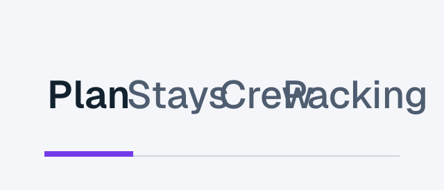
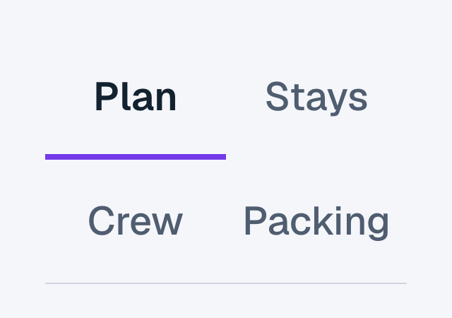
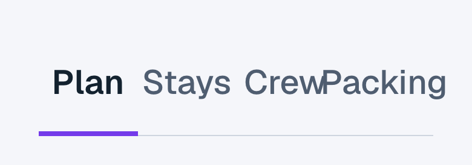
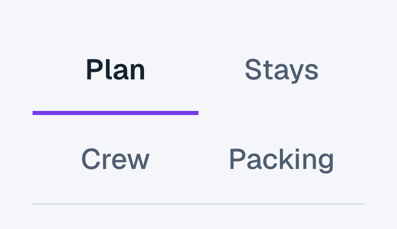

# #337 — Browser evidence for card-free group planning (web part)

Recorded November 16–17, 2026 for #337 (parent #329). This is the **web browser part only**: headless Chrome driving the real trip pages with fictional fixture data. It is not device, VoiceOver, signed-in production, second-session or participant evidence, and it doesn't stand in for any of them. Those are listed under [Untested surfaces](#untested-surfaces) and stay open on #337.

## Revision and environment

| | |
|---|---|
| Revision | `origin/main` at `b4e63d7` (Bump zod, #369), plus this PR's four fixes ([Bugs fixed](#bugs-fixed)). The final run ([`checks.json`](checks.json)) used all four. The "before" figures for each fix were measured before it was made: the tabs on `b4e63d7`, the others in a first full run that already had the tab fix. |
| Server | `next dev --turbopack` 16.4.2 from an isolated worktree on `localhost:3416`, with [`shim.patch`](shim.patch) applied (reverted before commit) |
| API | The app's own `/api/v1/trips/*` route handlers, run by [`api.mjs`](api.mjs) on `127.0.0.1:3417` against an in-memory fixture database ([How it works](#how-it-works)) |
| Browser | Headless Chrome 157.0.8103.51 (new headless), driven over the DevTools protocol by [`run.mjs`](run.mjs) |
| OS | macOS 27.0.1, Node 26.10.0 |
| Widths | 320, 390 (mobile viewport, touch), 768, 1024 (touch, as a tablet), 1440 (mouse); light and dark |
| Text and zoom | 200% text at 390 and 1440 (Chrome's default font size set to 32px with `Page.setFontSizes`; the root font size measured 32px). 400% zoom at 1280 × 1024, emulated as a 320 × 256 CSS px non-touch viewport. |
| Motion | `prefers-reduced-motion: reduce` and `no-preference` emulated |
| Clock | Each trip has a fixed "now" in the API and the browser: Sat Oct 10 2026 07:00 EDT (downhill), Sat Jan 9 2027 07:00 EST (backcountry) |

## Fixtures

[`fixtures.ts`](fixtures.ts) builds the database rows the API reads, reusing the reference journey from `src/test/splitStays.ts` (people, stays, per-person nights and Casey's attendance) and the places in `src/test/driveTrip.ts`. Everything is fictional; no account, trip or provider is real.

**Downhill — `qa337-downhill`, Fri Oct 9 – Mon Oct 12 2026** (stored as Alpine, shown as Downhill skiing)
- Six people: Alex (organizer), Blair, Casey and Eli (members), Dana (managed guest), Fran (pending invitation with nights planned).
- Fri and Sat nights: Alex, Blair and Dana in the Pine rental, Eli and Fran in the Village hotel at the same time. Casey arrives Saturday evening, skips Saturday and is the rental's fourth that night. Sun and Mon nights: all six in the Mountain lodge.
- Fri Travel; Sat at Stowe (meet 8:30 at Spruce Peak lot, ticket and rental notes); Sun at Smugglers' Notch (meet 9:00 at Smuggs lot); Mon at Stowe with **no meet time** (incomplete details).
- Distinct departures: Pine rental and Village hotel on Saturday; Eli's own starting point (Waterbury park and ride) on Sunday.
- Drive estimates: Saturday's two stored and fresh; Sunday's Pine rental one stored; Village hotel → Smuggs and Waterbury → Smuggs **not stored, and the routing provider is down** for the whole run; Monday's stored nine days ago (stale), and its refresh fails.
- Forecast: available at Stowe; the forecast provider answers **503** for Smugglers' Notch (Sunday).
- Kits: Alex's checklist, Eli's flagged "needs help", Dana's (managed by Alex); Blair, Casey and Fran not started. Shared gear: first aid kit (Alex, accepted), wax kit (Blair, awaiting acceptance), cooler (unassigned).

**Backcountry — `qa337-backcountry`, Fri Jan 8 – Mon Jan 11 2027** (stored as Backcountry, shown as Backcountry skiing)
- Same six people. Friday night: Alex, Blair and Dana in the Ridge rental; Casey, Eli and Fran in the Notch Brook inn. Sat and Sun nights: everyone in the ski-in Sterling Pond hut. Monday night: no stay (home).
- Saturday: one trailhead (Sterling Pond trailhead), meet 7:30, departures from the rental (estimate stored) and the inn (provider down). Tour plan with objective, route link, figures, **approach (ski or walk) separate from the road drive**, access notes, backup plan, return 3:30 PM and check-in plan.
- Official sources on Saturday: avalanche (Blair's review current), weather (Blair's review recorded against an older route: **stale**), access (**no review**). Sunday has two sources, unreviewed.
- Day checks: Alex both recorded, Blair's plan review recorded and transceiver check not, Dana's recorded by Alex, Eli's plan review out of date.
- Sunday: from the hut, **No drive planned**, meet at the hut, tour plan without a return time (incomplete). Monday (Travel): drive out from the hut, stored as **no road route**; the forecast provider fails for Jeffersonville.
- Personal equipment: Blair and Alex have transceiver, probe, shovel and skins in their lists (Blair has packed two). Shared touring items: first aid kit (Alex, packed), repair kit (Blair, accepted), group shelter (unassigned).

**Also:** `qa337-downhill-long` (the downhill trip with long names for every person, the trip and the stays) and `qa337-solo` (one person, two days). Viewers: `user-alex` (organizer), `user-blair`, `user-casey`, `user-eli` (members), `user-sam` (solo) and `user-zoe` (not on any trip).

## How it works

- [`api.mjs`](api.mjs) loads every `src/app/api/v1/trips/**/route.ts` with Vite's SSR loader and answers requests with them, unchanged. Only three modules are swapped ([`server/`](server)): sign-in returns the viewer from a cookie, the database client is `src/test/fakeSupabase.ts` over the fixture rows, and the rate limiter always allows. So `loadTripFull`, `tripFullFor`, the focus day, lodging, departures, drive estimates, checklist, packing, outing and preview responses are all the server's own. Saves reach the route, whose database call then fails (or returns a chosen Postgres error, such as `PT409`, through `/__qa/overrides`). The forecast provider is a stub; the routing provider always fails; any other outbound request is refused.
- [`shim.patch`](shim.patch) (applied only while testing, never committed as code) makes `/trips/qa337-*` pages skip Clerk, rewrites `/api/v1/trips/qa337-*` to the fixture API, enables `TripProvider` for those ids and has `useUserId` read the `qa337_viewer` cookie. The pages, layouts and components are otherwise the real ones.
- [`run.mjs`](run.mjs) (with [`cdp.mjs`](cdp.mjs)) drives headless Chrome: device metrics, touch, color scheme, reduced motion, default font size, a clock pin and an in-flight fetch counter so each page is measured after it settles. [`summarize.mjs`](summarize.mjs) condenses its output into [`checks.json`](checks.json).

### Re-running

From the worktree root, with dependencies installed and nothing else on ports 3416, 3417 or 9337:

```sh
git apply docs/qa/337-group-planning/shim.patch
API_PORT=3417 node docs/qa/337-group-planning/api.mjs &
./node_modules/.bin/next dev --turbopack -p 3416 &
OUT=/tmp/qa337 node docs/qa/337-group-planning/run.mjs          # or: run.mjs layout a11y text motion journeys failures focus shots
node docs/qa/337-group-planning/summarize.mjs /tmp/qa337/results.json
# stop both servers, then:
git apply -R docs/qa/337-group-planning/shim.patch && rm -rf .next/dev
```

Use `localhost`, not `127.0.0.1`, for the Next server: Next 16 blocks dev resources for an origin it doesn't recognise, and the pages never hydrate.

## Results

"Pass" here means the browser check passed against fixture data in headless Chrome. It is not device, assistive-technology, signed-in or participant evidence.

| Check | Result | Evidence |
|---|---|---|
| Both journeys render through the real pages, organizer and member | Pass | Plan, day, Stays, Crew, Day checklist, Packing and Shared gear for Alex (organizer) and Blair (member) on both trips, plus Casey, Eli, the long-name trip, the solo trip and a person not on the trip. No console errors in 280 page states. |
| Member finds meet time and place, own starting point and tonight's stay on the day page | Pass, with one contradiction (bug below; fixed on main by #378, checked again in #401) | Downhill Saturday at 390 px: Meet "8:30 AM EDT · Sat Oct 10 · Spruce Peak lot" at y=583, Starting from at y=787 (Blair: Pine rental; Eli: Village hotel), Staying tonight at y=1552, all before Weather (1688) and My kit (1892). Casey sees "You're not taking part this day." at y=451 and Pine rental tonight. Eli's own starting point on Sunday is right under Your drive but contradicted by Meet and start ([Bugs found](#bugs-found-but-not-fixed)). |
| Backcountry: objective, backup, return/check-in and sources before clothing and equipment | Pass | At 390 px: route in the header (y=423), meet (675), starting point (751), ski/walk approach (1453), backup (2063), return 3:30 PM (2167), check-in (2223), avalanche source (2637), stale review "Route changed" (3122), unreviewed access source (3339), then Weather (3635), My kit (3839), My equipment (4319), Transceiver check (5128). The same order holds at 320 and 1440 and in the accessibility tree's headings. A recorded review ("You reviewed this source Fri Jan 8, 6:10 PM"), a packed item ("Packed" / "Not packed yet" under My equipment) and a day check ("Transceiver check") are separate, differently labelled sections. "A recorded review notes who looked at a source and when. It doesn't mean the forecast is current or the plan is safe." is on the page. |
| Road drive vs ski/walk approach; hut with No drive planned; no road route | Pass | Saturday's drive (Ridge rental → Sterling Pond trailhead, 19 min) and "Approach (ski or walk)" are separate sections. Sunday: "Starting from Sterling Pond hut · No drive planned". Monday from the hut: "No road route found". |
| Split stays: move only two people for one night, mornings predicted before saving | Pass (preview; the save itself is untested) | Change nights for Saturday at Pine rental, Blair and Dana to the Village hotel: the server's preview says "Move Blair and Dana from Pine rental to Village hotel for the night of Sat Oct 10. Nobody else's nights change." and, under The mornings after, "Sun Oct 11: Blair starts from Village hotel" and the same for Dana. Replacing their planned night needs an explicit tick. Pending invitations aren't part of Everyone. At 390 and 1440. |
| Opening the trip lands on today | Pass | With the tab's session storage cleared, `/trips/<id>/days` opened Sat Oct 10 (downhill, member and organizer), Sat Jan 9 (backcountry) and the solo trip's Saturday. (Without clearing it, a day the tab had already shown wins, as #334 intends.) |
| Pending invitation, managed guest, late arrival, incomplete details | Pass | Fran shows "invitation pending" with Copy, Share, Revoke and Replace link for the organizer (Crew), "(invitation pending)" in Stays and her own "Invitation pending" group in the Day checklist, and isn't counted in "Everyone on the crew". Dana shows "Managed guest", and only the organizer can change her kit. Casey is under "There, not taking part" on Saturday with "Nothing to plan". Monday (no meet time) showed "Start of the day" without a Meet row (fixed in #401: "Meet: Not set yet · Spruce Peak lot"); Sunday's tour plan has no return time. Both render without errors. |
| No access | Pass | A signed-in person not on the trip gets "Not found" inside the workspace; nothing from the trip shows. |
| No default content cards (Plan, Stays, Crew, Packing, day, Day checklist, Shared gear) | Pass | 280 page states (2 trips × organizer/member × 7 pages × 5 widths × light/dark): no framed, shadowed or filled content block. The one flag was the Crew page's "Invite link / Managed guest" switch, a form control. Editors (notes, tour plan, nights) are framed, as #329 allows. |
| No essential horizontal page scroll | Pass at 100% text and 400% zoom; fixed at 200% text | 0 of 280 states at 320/390/768/1024/1440, and 0 of 28 pages at 320 × 256 CSS px (400% of 1280). At 200% text the date strip scrolls inside itself, by design. At 200% text on a 390 px phone the first run found all 28 pages 454–520 px wide; after fixes 1 and 2 all 28 are 390 px. 320 px **and** 200% text together still overflow ([Bugs found](#bugs-found-but-not-fixed)). |
| 200% text | Pass after fixes | 56 page loads at 390 and 1440 with the root font size at 32 px. Before: section tabs overlapping, menu button off-screen, touring buttons past the edge. After: no overflow, no text spilling out of its box, no content cut off. |
| 44 px targets on primary controls | Pass on touch | 8,192 controls at 320/390/768/1024 (touch): none under 44 × 44 px apart from inline text links (map data attribution, Day checklist status values, stay names in My stays). The Day checklist status values are 44 px on touch since #401. 2,282 controls at 1440 (mouse): the desktop sizes, 36 px buttons and chips and 40 px sidebar rows; none under 24 px. |
| Visible focus, keyboard order, focus return | Pass | Tab through 56 page states (390 and 1440): every one of 2,092 Tab stops had a visible focus indicator (the long organizer day pages were capped at 80 stops), none was out of view or under the sticky tabs or header. Notes: Enter opens the editor with focus in the field, Cancel returns it to Edit notes. Add stay and both Change nights sheets: focus moves inside, Escape returns it to the button that opened them (390 drawer, 1440 dialog). |
| Accessible names | Pass after fix 3 | No unnamed button, link, field, checkbox or tab among 2,070 interactive nodes in the accessibility tree on the 56 states. The organizer's repeated kit controls now sit in groups named for whose kit they change. One `<h1>` per page; landmarks: Primary and Trip sections navigation, Choose a day, main, and a region per day section. |
| Light and dark | Pass | Every layout check ran in both, with the same results. Contrast wasn't measured. |
| Reduced motion | Pass | With `prefers-reduced-motion: reduce`, no element on Plan, day or Stays animates or transitions longer than the global cap (0.01 ms); without it, 14–57 elements use 150 ms transitions. |
| Long names | Pass after fix 4 | The long-name trip at 320 px: no overflow on day, Stays, Crew, Day checklist or Plan. Before the fix, Crew cut five names off with an ellipsis and the day's kit rows two; now they wrap. |
| Failed save keeps input | Pass | Day notes: "Couldn't save the notes. Nothing was changed; try again." with the text kept and focus in the field; same for a 503 HTML page ("Request failed (503)"). Tour plan editor: "Couldn't save the tour plan. Your changes are still here; try again." with the backup plan kept. Lodging: "Couldn't save lodging. Your changes are still here; try again." with the preview kept. |
| Concurrent edit (409) | Pass | Notes: "The notes changed since you opened them. Check them, then try again." with the text kept and Review saved notes. Lodging: "The lodging plan changed. Review the saved plan before retrying." with Review saved plan. Both from the routes' own handling of `PT409`. |
| Unavailable forecast and routing; stale estimate | Pass | Forecast provider down: "Couldn't load the forecast. Retry weather or plan your kit manually." with Retry weather. Routing provider down: Eli's own drive from the park and ride says "Drive estimate unavailable" with Retry (the API marks the Village hotel departure unavailable too), while the stored Pine rental estimate still shows. Stale: "Calculated 9 days ago" with Retry. |
| Trip fails to load | Pass, no retry control (bug below; Retry added in #401) | "Couldn't load the trip. Try again." inside the workspace; the trip came back on the next window focus. |

## Bugs fixed

Each fix has a test, and the final run measured it in the browser.

1. **Section tabs ran into each other with enlarged text.** At 200% text on a phone, Plan · Stays · Crew · Packing kept four equal columns, and the labels spilled over each other ("StaysCrewPacking"): at 320 px, Stays needed 69 px of a 64 px column, Crew 66 and Packing 85; at 390, Packing needed 93 of 82. The bar is now a container and shows four in a row only when it's at least 17.5rem wide. Because the container query is in rem, it follows the text size: at normal size nothing changes from 320 px up, and with large text on a phone the tabs go two by two. Measured after: every tab fits its column at 320 and 390 with 200% text, and the four stay in one row at 768 and 1440. Focus never landed under the two-row sticky bar during a full Tab pass at 320 and 390 with 200% text. (`TripWorkspace.tsx`)
2. **Every trip page scrolled sideways at 200% text on a 390 px phone**, with the menu button off-screen. Two causes: the header's SWTTR wordmark was sized in rem, so it doubled with the text (all 28 page/role pairs were 454–520 px wide), and the "Add touring equipment" / "Add more touring equipment" / "Add shared touring items" buttons kept their labels on one line (up to 520 px). The wordmark now keeps its pixel size (it's a logo, not text to read), and those three buttons wrap their labels. (`Header.tsx`, `TouringEquipment.tsx`, `TripPacking.tsx`)
3. **The organizer's kit controls didn't say whose kit they change.** On a day page the organizer can edit their own kit and every account-free person's (the managed guest, and a pending invitation), so the accessibility tree had three each of Shirt, Midlayer, Jacket, Shell, Pants, Gloves, Easy, Steady, Hard and Flag needs help with nothing to tell them apart. Each editable row is now a group named for its person: "Alex's kit" (or "Your kit" while the organizer's row is still called You), "Dana's kit", "Fran's kit". (`days/[date]/page.tsx`)
4. **Long names were cut off with an ellipsis** on Crew (five of six names at 320 px) and in day kit rows (two), where the name is the only thing identifying the person, such as "Dana Vanderbilt-Castellanos de la Vega". They wrap now. (`manage/page.tsx`, `days/[date]/page.tsx`)

Automated checks for the fixes: `TripWorkspace.test.tsx` (tab layout classes), `Header.test.tsx` (wordmark sizes), the day page test (kit groups named per person, names wrap, touring button wraps), and the Crew, Packing and Shared gear page tests. jsdom doesn't lay out, so these pin the classes; the browser measurements above are the layout evidence. With the shim reverted, `npm run lint`, `npm run knip`, `npm run typecheck` and `npm run build` passed. The full suite (219 files) passed apart from six files that timed out under a machine load around 60 (`src/app/page.test.tsx`, the stops page, `mpp.test.ts` and three PGlite database tests); those six passed (133 tests) when rerun on their own.

## Bugs found but not fixed

| Severity | Where | What happens | Recommended fix | Status |
|---|---|---|---|---|
| Medium | Day page, Meet and start (#333/#334) | A person with their own starting point for the day sees two different ones on the same page. Eli on Sunday: **Meet and start · Starting from: Village hotel** (the stay he slept in), then **Your drive · Starting from Waterbury park and ride · only this day**. "Crew starting from" also counts him at the hotel. The lodging summary's `starting_from` ignores `member_origins` and a day's own `origin`; the drive uses them. | Have the API fold people's own starting points and the day's origin (and No drive planned) into each person's `days[].starting_from` and the crew summary, so `DayStart` and `DayDrive` read one server value. The #333–#335 gap work is editing the day page, so this is left to it. | **Fixed on main by #378**, which added `starts` (built by `dayStarts` from the departures) to `GET /api/v1/trips/:id` for `DayStart` to read. Checked again in #401: Eli on Sunday reads "Starting from: Waterbury park and ride · only this day", as Your drive does, and Crew starting from counts him there ("Pine rental (4) · Village hotel (1) · Waterbury park and ride (1)"). |
| Low | Every trip page | When the trip fails to load, the page says "Couldn't load the trip. Try again." with nothing to press. It recovers when the window regains focus, comes back online, or reloads (measured: the 500 cleared and the day came back on a focus event). | Give `TripError` an optional Retry button wired to the page's `refresh` when there's no data. | **Fixed in #401.** `TripError` takes `onRetry`; Plan, the day, Stays, Compare stays, Crew, Settings, the trip map and the opening redirect pass the trip's refresh while they have no trip. Checked again: with the trip read failing, Retry (44 px) sits under the alert, and pressing it brought the day back with no focus event. |
| Low | Day page, Meet and start | A day without a meet time shows "Start of the day" and no Meet row, so a member can't tell "not set yet" from "no meet". | Show "Meet: not set yet · <access point>" on activity days with an access point. | **Fixed in #401.** On a day whose activity is set and isn't Travel or Rest, with an access point, Meet and start reads "Meet: Not set yet · <access point>". Checked again: downhill Monday as Blair reads "Meet and start", "Not set yet · Spruce Peak lot". |
| Low | Phones with 200% text | At 390 px the pages now fit, but the fixed bottom tab bar (Gear up · Trips · Wardrobe) cuts off "Wardrobe" at the right edge. At 320 px with 200% text (beyond the matrix) pages still scroll sideways by 44–56 px: single-line buttons such as Plan my layers, Change meet time, Refresh shared gear, Create invite link and the packing quantity steppers. 320 px at 100% text (400% zoom) is clean. | Let the shared `Button` wrap long labels (`whitespace-normal h-auto min-h-11`) on narrow screens and let the tab bar labels shrink or wrap; it's a design-system change, so it isn't in this PR. | **Left**: needs a design-system decision on the shared `Button` and the tab bar. |
| Low | Day checklist (Crew) | The status values are inline links 21 px tall on phones. They pass WCAG 2.2 AA 2.5.8 through its spacing exception but not the product's 44 px target. | Give them a 44 px hit area on coarse pointers (`pointer-coarse:inline-flex pointer-coarse:min-h-11 pointer-coarse:items-center`) if the denser rows are acceptable. | **Fixed in #401** with those classes. Checked again: the 15 status links at 390 px (touch) are 44–48 px tall; at 1440 with a mouse they stay 21 px. |
| Cosmetic | Shared gear | "Accepted by you · 1/3/2027, 7:00:00 AM" uses the browser's default date format with seconds, unlike every other time on the trip. | Use the trip's date/time label helpers. | **Fixed in #401.** The trip API sends `accepted_label` and `packed_label`, made by the day checks' `checkTimeLabel` on the trip's clock (the first day whose destination time zone is known, else UTC). Checked again: "Accepted by Alex · 8:00 AM EDT · Thu Oct 1". |

**Re-checked for #401** (November 18, 2026): `next dev` from that branch with `shim.patch` applied and the record's `api.mjs` fixture API, driven by a short script built on `cdp.mjs` for rows 1, 2, 3, 5 and 6 above. Fixture data only; no console errors.

Not bugs, for the record: opening a trip goes to a day the tab already showed, by design (#334), so the focus-day check clears the tab's session storage first; the Crew add-member "Invite link / Managed guest" switch was flagged by the card detector, but it's a form control.

## Untested surfaces

This browser pass does not cover any of the following; they stay open on #337.

- **Physical devices and the installed app:** iPhone and iPad, the Capacitor shell, native tab bar and navigation (#361, #146, #144), real safe areas, the real on-screen keyboard (fields scrolled above it, iOS date and time inputs). Chrome's touch and mobile emulation isn't WebKit.
- **VoiceOver and other screen readers.** Only Chrome's accessibility tree (names, roles, headings, landmarks) and keyboard focus were checked.
- **Signed-in production:** a real Clerk session, the real database and its RPCs, revisions and authorization. No save succeeded here; only the failure paths (database error, `PT409` conflict, 503 HTML page) ran.
- **Successful saves and their retries,** and concurrent edits from two real sessions.
- **Reload and second-session persistence** of personal and shared state. The fixture database is in memory and refuses writes, so nothing here is evidence of persistence.
- **Invitation acceptance, expiry and revocation flows.** Only "not on the trip" (404 → "Not found") was checked.
- **Maps:** canvas, geometry, map/list failure and performance belong to #235.
- **Real forecast and routing providers** (both stubbed), and the Gear up round trip from a trip day (#335): Plan my layers rendered but wasn't followed.
- **Other browsers** (Safari, Firefox), real browser zoom (the text checks changed the default font size), forced colors, and text contrast (not measured in this pass).
- **The participant study** (six travelers; five completing core logistics unaided and finding their day logistics within 15 seconds). Not run; nothing here is a usability result.

## Screenshots

Fixture data only, headless Chrome at 2× (full page unless noted). Hosted on the `pr-assets` branch (commit `e50ae9f`).

| Before | After |
|---|---|
| <br>Section tabs, 320 px, 200% text |  |
| <br>Section tabs, 390 px, 200% text |  |
| [Day page, 390 px, 200% text, before](https://raw.githubusercontent.com/derobertsw/swttr/e50ae9ff1200225a6c3830009e58f467cf6be499/pr-385/before-downhill-day-member-390-200pct-text.png) (menu button off-screen, tabs overlapping) | [after](https://raw.githubusercontent.com/derobertsw/swttr/e50ae9ff1200225a6c3830009e58f467cf6be499/pr-385/downhill-day-member-390-200pct-text.png) |

- **Downhill, member day brief:** [Blair, 390 light](https://raw.githubusercontent.com/derobertsw/swttr/e50ae9ff1200225a6c3830009e58f467cf6be499/pr-385/downhill-day-member-390-light.png) · [Blair, 390 dark](https://raw.githubusercontent.com/derobertsw/swttr/e50ae9ff1200225a6c3830009e58f467cf6be499/pr-385/downhill-day-member-390-dark.png) · [Casey (not taking part), 390](https://raw.githubusercontent.com/derobertsw/swttr/e50ae9ff1200225a6c3830009e58f467cf6be499/pr-385/downhill-day-casey-390-light.png) · [Eli, Sunday, 320 (two different starting points)](https://raw.githubusercontent.com/derobertsw/swttr/e50ae9ff1200225a6c3830009e58f467cf6be499/pr-385/downhill-day-eli-sunday-320-light.png)
- **Downhill, organizer and desktop:** [day beside the days list, 1440](https://raw.githubusercontent.com/derobertsw/swttr/e50ae9ff1200225a6c3830009e58f467cf6be499/pr-385/downhill-plan-organizer-1440-light.png) · [Stays, people by night, 1440](https://raw.githubusercontent.com/derobertsw/swttr/e50ae9ff1200225a6c3830009e58f467cf6be499/pr-385/downhill-stays-organizer-1440-light.png) · [Stays, member, 390 dark](https://raw.githubusercontent.com/derobertsw/swttr/e50ae9ff1200225a6c3830009e58f467cf6be499/pr-385/downhill-stays-member-390-dark.png) · [Crew, 390](https://raw.githubusercontent.com/derobertsw/swttr/e50ae9ff1200225a6c3830009e58f467cf6be499/pr-385/downhill-crew-organizer-390-light.png) · [Day checklist, 1024](https://raw.githubusercontent.com/derobertsw/swttr/e50ae9ff1200225a6c3830009e58f467cf6be499/pr-385/downhill-rollcall-organizer-1024-light.png)
- **Split stays:** [move Blair and Dana for one night, preview, 390](https://raw.githubusercontent.com/derobertsw/swttr/e50ae9ff1200225a6c3830009e58f467cf6be499/pr-385/stays-move-two-preview-390.png) · [same, 1440 dialog](https://raw.githubusercontent.com/derobertsw/swttr/e50ae9ff1200225a6c3830009e58f467cf6be499/pr-385/stays-move-two-preview-1440.png)
- **Backcountry:** [Saturday, member, 390](https://raw.githubusercontent.com/derobertsw/swttr/e50ae9ff1200225a6c3830009e58f467cf6be499/pr-385/backcountry-day-member-390-light.png) · [Saturday, 1440 dark](https://raw.githubusercontent.com/derobertsw/swttr/e50ae9ff1200225a6c3830009e58f467cf6be499/pr-385/backcountry-day-member-1440-dark.png) · [Sunday from the hut, No drive planned](https://raw.githubusercontent.com/derobertsw/swttr/e50ae9ff1200225a6c3830009e58f467cf6be499/pr-385/backcountry-hut-nodrive-390-light.png) · [Monday, no road route](https://raw.githubusercontent.com/derobertsw/swttr/e50ae9ff1200225a6c3830009e58f467cf6be499/pr-385/backcountry-driveout-noroute-390-light.png) · [Packing with touring equipment, 768](https://raw.githubusercontent.com/derobertsw/swttr/e50ae9ff1200225a6c3830009e58f467cf6be499/pr-385/backcountry-packing-member-768-light.png) · [400% zoom (320 × 256)](https://raw.githubusercontent.com/derobertsw/swttr/e50ae9ff1200225a6c3830009e58f467cf6be499/pr-385/backcountry-day-member-400pct-reflow.png)
- **Long names:** [Stays, 320](https://raw.githubusercontent.com/derobertsw/swttr/e50ae9ff1200225a6c3830009e58f467cf6be499/pr-385/long-names-stays-organizer-320-light.png)
- **Failures:** [notes save failed, input kept](https://raw.githubusercontent.com/derobertsw/swttr/e50ae9ff1200225a6c3830009e58f467cf6be499/pr-385/failure-notes-save-390.png) · [notes 409 conflict](https://raw.githubusercontent.com/derobertsw/swttr/e50ae9ff1200225a6c3830009e58f467cf6be499/pr-385/failure-notes-conflict-390.png) · [tour plan save failed](https://raw.githubusercontent.com/derobertsw/swttr/e50ae9ff1200225a6c3830009e58f467cf6be499/pr-385/failure-tour-plan-save-390.png) · [trip load failed](https://raw.githubusercontent.com/derobertsw/swttr/e50ae9ff1200225a6c3830009e58f467cf6be499/pr-385/failure-trip-load-390.png)
